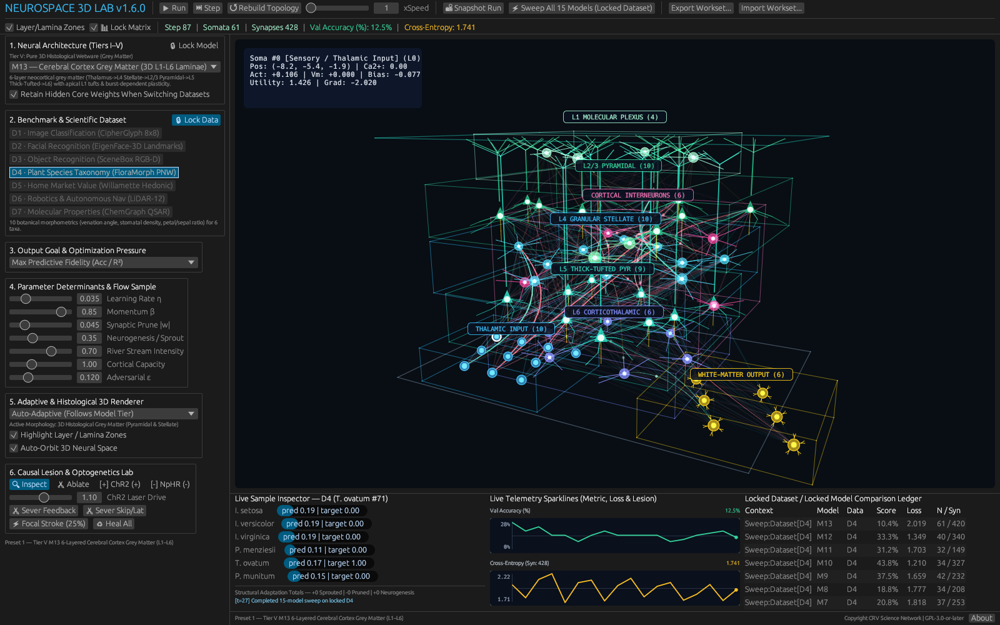

# NeuroSpace Lab (`neurospace-lab` v1.6.0)

Native safe-Rust (`#![forbid(unsafe_code)]`) 3D Neural Network Topology, Structural Plasticity & Cerebral Cortex Grey-Matter Workstation built with `eframe`/`egui` `0.31`, `glam` `0.29`, bundled `rusqlite` `0.32` (WAL), and `clap` `4.5`, paired with a synchronized Three.js `r128` browser observatory (`web/neurospace_lab_preview.html`).

- **Website**: [CRV Science Network](https://crvscience.com) · [CRV Science Public Apps](https://crvscience.com/apps)
- **User Guide**: [docs/USER_GUIDE.md](docs/USER_GUIDE.md)
- **Scientific Methods**: [docs/SCIENTIFIC_METHODS.md](docs/SCIENTIFIC_METHODS.md)
- **License**: GNU General Public License v3.0 or later (`GPL-3.0-or-later`, see [LICENSE](LICENSE))



---

## Build & Run Quickstart

```bash
# Build and launch the interactive 3D native workstation
cargo run --release

# Run full unit & integration test suite (serializing parallel jobs safely on modest RAM hosts)
CARGO_BUILD_JOBS=4 cargo test --all-targets

# Headless CLI: lock Plant Species (D4) and sweep all 15 neural architectures
cargo run --release -- bench-dataset --dataset D4 --steps 80

# Headless CLI: lock Cerebral Cortex Grey Matter (M13) and sweep all 7 datasets
cargo run --release -- bench-model --model M13 --steps 80

# Render a 1600x1000 offscreen GPU PNG screenshot (preset 1 = M13, 2 = M11, 3 = M14)
cargo run --release -- --headless-screenshot out/cortex.png --screenshot-view 1
```

---

## Interactive Controls & Hotkeys

All single-key navigation and wetbench shortcuts are guarded by `!ctx.wants_keyboard_input()` so typing in UI inputs never triggers hotkeys.

| Input / Hotkey | Action |
|---|---|
| `Left-Drag` | Orbit 3D Neural Space with smooth inertial damping |
| `Right-Drag` / `Middle-Drag` | Pan 3D camera focal target in screen plane |
| `Scroll Wheel` | Zoom camera distance (`8.5 .. 54.0`) |
| `1` / `2` / `3` / `4` | Smooth damped camera presets: Isometric / Sagittal (`X-Y`) / Coronal (`Y-Z`) / Top-Down (`X-Z`) |
| `R` | Reset camera to default Isometric + Auto-Orbit |
| `A` | Toggle camera auto-orbit |
| `Space` | Play / Pause continuous training & dynamical integration |
| `N` or `.` | Pause and single-step simulation by 1 tick |
| `I` / `X` / `E` / `S` | Select Probe Tool: Inspect / Focal Ablation / ChR2 Excite (`+`) / NpHR Silence (`-`) |
| `Shift + Click` soma | Quick toggle focal lesion ablation on hovered soma |
| `Alt + Click` soma | Quick toggle optogenetic ChR2 excitation clamp on hovered soma |
| `F5` / `F9` | SQLite WAL QuickSave / QuickLoad (`quicksave_f5` slot) |
| `Ctrl/Cmd + S` / `Ctrl/Cmd + O` | Export / Import SHA-256 verified `.neuroworkset.json` snapshot |
| `F1` | Toggle About & Keyboard / Optogenetics Field Guide modal |
| `Esc` | Close Help modal first, then clear selected neuron inspection card |

---

## CLI Flags & Subcommands

| Flag / Subcommand | Arguments & Defaults | Behavior |
|---|---|---|
| *(none)* / `gui` | — | Launches the native `1440x900` `eframe`/`wgpu` 3D workstation |
| `--headless-screenshot <PNG_PATH>` | `--screenshot-view <1\|2\|3>` (default `1`) | Renders a `1600x1000` offscreen RGBA PNG via `wgpu` and exits |
| `bench-dataset` | `-d, --dataset <D1..D7>` (`D4`), `-s, --steps <N>` (`60`) | Locks dataset and benchmarks all 15 architectures (`M0`–`M14`) |
| `bench-model` | `-m, --model <M0..M14>` (`M13`), `-s, --steps <N>` (`60`) | Locks architecture and benchmarks all 7 datasets (`D1`–`D7`) |
| `export-sample-workset` | — | Steps `M13` on `D7` for 25 ticks and prints SHA-256 `.neuroworkset.json` to stdout |

---

## Scientific Summary & Architecture

NeuroSpace Lab models **15 architectures across 5 evolutionary tiers** evaluated over **7 deterministic scientific benchmarks**, with real-time structural plasticity (pruning, axonal sprouting, neurogenesis, compensatory peri-infarct bypass), causal optogenetic clamping (`ChR2`/`NpHR`), tractotomy, and genuine FGSM/PGD `L∞` robustness evaluation.

| Module | Role | Key Capabilities |
|---|---|---|
| `src/models.rs` | Taxonomy & Hyperparameters | `ModelTier` (I–V), `ModelArch` (`M0`–`M14`), `OutputGoal` (5 objectives), `RenderMode` (5 modes), `HyperParams` |
| `src/datasets.rs` | Deterministic Benchmarks | `D1`–`D7` synthetic-scientific cohorts (`240` train + val split) across classification, regression, kinematic control, and multi-property QSAR |
| `src/engine.rs` | Simulation & Plasticity Engine | Synchronous wavefront backprop (`1 - a²`), exponential LIF leak (`exp(-dt / τ)`), asymmetric STDP (`A+ x_pre s_post - A- x_post s_pre`), two-compartment M13 L1 apical vs. basal `Ca²⁺` integration, FGSM/PGD evaluation, incremental non-blocking sweeps |
| `src/renderer_3d.rs` | Safe-Rust 3D Renderer | Homogeneous 4D near-plane & frustum segment clipping, 3D world-space cubic Bezier flow wisps, lit 3D pyramidal prisms & tapered apical cylinders with depth fog, damped orbit/pan/zoom camera |
| `src/gui.rs` | Workstation HUD | Non-blocking batch sweep progress bar, `!wants_keyboard_input()` hotkeys, sparklines with lesion event tags, X-axis sample ticks & Pre/Acute legend, expanded `F1` help modal |
| `src/persistence.rs` | Persistence & Integrity | Bundled SQLite WAL (`save_slots`, `comparison_runs`) + canonical SHA-256 `.neuroworkset.json` worksets |

### 15 Architectures (`M0`–`M14`)

- **Tier I — Classical & Mechanistic**: `M0` Minimal Single-Layer Perceptron, `M1` Deep MLP, `M2` Volumetric 3D-CNN, `M3` Multi-Head Sparse Attention Transformer.
- **Tier II — Frontier LLM & Adversarial/Evolutionary**: `M14` Frontier Autoregressive LLM (Causal GQA + KV-Cache + Top-2 Sparse MoE across 4 SwiGLU quadrant experts), `M4` Minimax GAN, `M5` Adversarial Robust Network (PGD-AT), `M6` GANN/NEAT.
- **Tier III — Spiking & Continuous Dynamical**: `M7` Leaky Integrate-and-Fire Spiking (`exp(-dt/τ)` + asymmetric trace STDP + Dale's Law), `M8` Liquid Time-Constant ODE (`LTC`), `M9` Chaotic Echo-State Reservoir.
- **Tier IV — Biological & Cortical Algorithms**: `M10` Hierarchical Predictive Coding (Value/Error Free-Energy), `M11` Thousand-Brains HTM Columns (`k`-WTA), `M12` Connectomic Organoid & Protoplasmic Astrocytes.
- **Tier V — Pure 3D Histological Grey Matter**: `M13` 6-Layered Cerebral Cortex (`Thalamus → L4 Spiny Stellate → L2/3 Pyramidal → L5 Thick-Tufted Pyramidal → L6 Corticothalamic` with `L1` apical tuft feedback & Basket/Martinotti interneurons).

---

## Validation Metrics

Baseline manifest recorded in [`validation/neurospace_lab_validation_summary.json`](validation/neurospace_lab_validation_summary.json):

| Metric | Value | Source |
|---|---|---|
| Package Version | `1.6.0` | `Cargo.toml`, `validation/neurospace_lab_validation_summary.json` |
| Unsafe Code Policy | `forbidden` (`#![forbid(unsafe_code)]`) | `src/lib.rs`, `tests/integration_suite.rs` |
| Models / Datasets | `15` (`M0`–`M14`) / `7` (`D1`–`D7`) | `src/models.rs`, `src/datasets.rs` |
| Preprint Reference | `APP-PREPRINT-19` | `validation/neurospace_lab_validation_summary.json` |
| Baseline Validation Suite | `13 passed / 13 total` (`2.17 s`) | `validation/neurospace_lab_validation_summary.json` |
| Upgraded Integration Suite | `20 passed; 0 failed; 0 ignored` (`0` compiler warnings via `CARGO_BUILD_JOBS=4 cargo test --all-targets`) | `tests/integration_suite.rs` |

---

## Citation & License

If you use NeuroSpace Lab in research or teaching, please cite [`CITATION.cff`](CITATION.cff) and the companion preprints in [`Preprints/`](Preprints/README.md):

- **APP-PREPRINT-19**: Bryan P. White (2026), *NeuroSpace Lab: 3D Neural Network Topology, Structural Plasticity, and Six-Layered Cerebral Cortex Simulation in Rust*, Zenodo DOI: `10.5281/zenodo.24263468`.
- **APP-PREPRINT-01**: Bryan P. White (2026), *The CRV Science App Network: Twenty Open-Source Rust Programs for Science, Data, and Simulation*, Zenodo DOI: `10.5281/zenodo.24222398`.

Licensed under the **GNU General Public License v3.0 or later (`GPL-3.0-or-later`)**. See [LICENSE](LICENSE).
